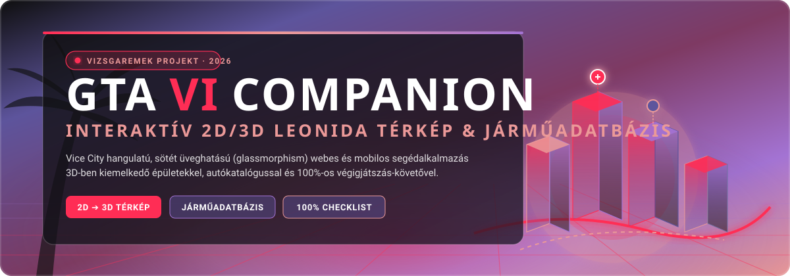
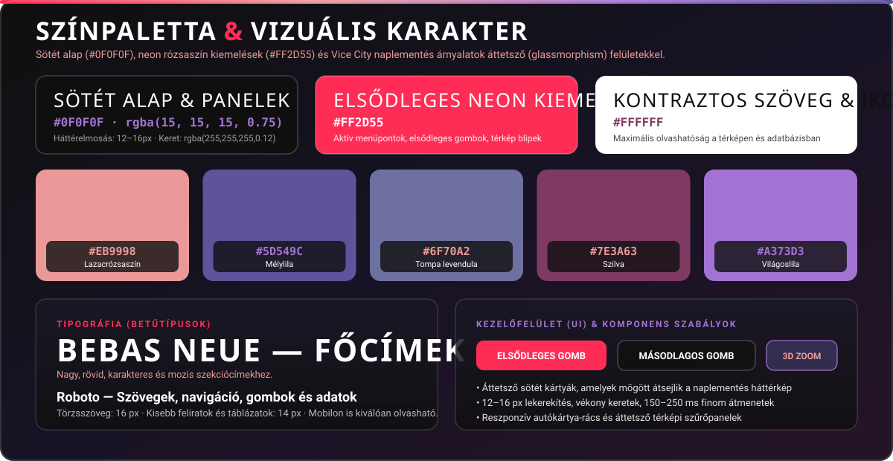
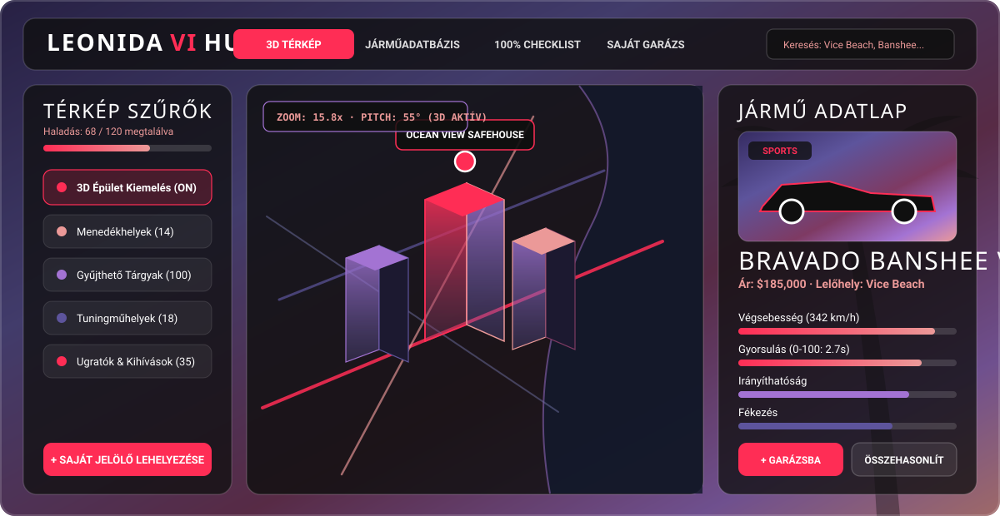
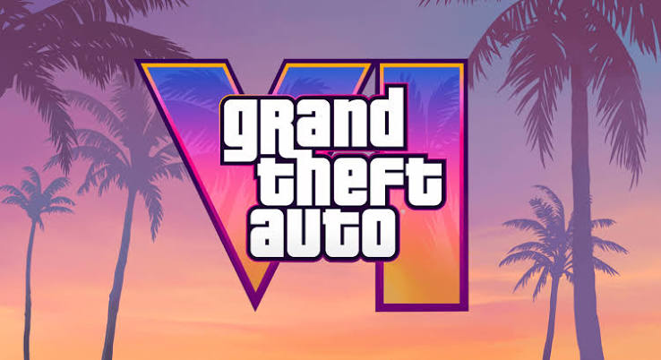

# GTA 6 Interaktív Segédalkalmazás (Vizsgaremek)

**Készítők:** Baranyai Noel Ákos · Sikler Dominik · Cserháti Bence

## Projekt Ötlet
Egy interaktív **Grand Theft Auto VI** segédalkalmazás (*companion app*), amelynek fő eleme egy 2D/3D-s interaktív Leonida / Vice City térkép, egy részletes járműadatbázis és több hasznos játékbeli segédeszköz.  
A fejlesztés fő fókuszában a **Webalkalmazás** és a **Backend** áll, a mobilos támogatás pedig az utolsó fázisban készül el.

Technikai részletek és térkép-implementációs terv: [Technical-Overview.md](./Technical-Overview.md)

---

## Funkciók és Ötletek (Kategóriánként)

### 1. Interaktív Térkép (Leonida & Vice City)
- [ ] GTA 6 stílusú 2D alaptérkép egyedi színvilággal és radar ikonokkal (*Blips*)
- [ ] **3D Zoom funkció:** ráközelítéskor a kamera megdől, és az épületek 3D-ben kiemelkednek a 2D környezetből
- [ ] Kategóriaszűrők (Menedékhelyek, Gyűjthető tárgyak, Ugratók, Fegyverek, Tuningműhelyek, Easter Eggek)
- [ ] Megtalált helyszínek / tárgyak kipipálása közvetlenül a térképen
- [ ] Saját felhasználói jelölők (Custom Pins) és jegyzetek lehelyezése
- [ ] Kattintható 3D épületek és pontok részletes információs ablakkal (kép, leírás, jutalom)

### 2. Járműadatbázis és Garázs
- [ ] Kereshető és szűrhető autókatalógus (kategória, gyártó, ár, sebesség szerint)
- [ ] Jármű adatlapok részletes statisztikákkal (végsebesség, gyorsulás, fékezés, irányíthatóság)
- [ ] Jármű-összehasonlító eszköz (2–3 autó statisztikáinak egymás melletti összevetése)
- [ ] Saját Garázs és Kívánságlista (megszerzett és kiszemelt autók mentése)

### 3. 100% Végigjátszás és Küldetéskövető
- [ ] Fő- és mellékküldetések ellenőrzőlistája (Checklist)
- [ ] Összesített előrehaladási százalék és statisztika
- [ ] Spoiler-mentes mód (későbbi küldetések adatainak elrejtése)

### 4. Kiegészítő Eszközök és Közösség
- [ ] Fegyver- és felszerelés-adatbázis
- [ ] Rablás (Heist) és üzleti profit kalkulátor
- [ ] Vice City rádióállomások és zenelista böngésző
- [ ] Közösségi beküldések (játékosok által talált új helyszínek beküldése)

### 5. Felhasználói Fiók és Adminisztráció
- [ ] Regisztráció, bejelentkezés és felhőalapú mentés-szinkronizáció
- [ ] Admin felület (CRUD): új járművek, küldetések és térképpontok felvétele/szerkesztése
- [ ] Közösségi beküldések jóváhagyása Admin által

### 6. Későbbi Fázis (Mobil Támogatás)
- [ ] iOS kliens (SwiftUI)
- [ ] Android kliens (Natív / Angular Ionic)
- [ ] Helyi offline adatbázis-gyorsítótárazás mobilon

---

## Stílusirány és Vizuális Megjelenés

A felület a **Vice City** naplementés hangulatára épül: rózsaszín-lila neon kiemelések, karakteres főcímek és áttetsző, sötét üveghatású (*glassmorphism*) kezelőfelületek, amelyek mögött átsejlik a naplementés háttérkép.

### Színpaletta és Tipográfia

| Szerep | Színkód | Leírás |
| :--- | :--- | :--- |
| **Sötét alap / Panelek** | `#0F0F0F` / `rgba(15, 15, 15, 0.75)` | Áttetsző sötét kártyák 12–16 px háttérelmosással (*backdrop-blur*) |
| **Szöveg** | `#FFFFFF` | Kontrasztos fehér szöveg a maximális olvashatóságért |
| **Elsődleges kiemelés** | `#FF2D55` | Aktív menüpontok, elsődleges gombok, kiemelt 3D térképpontok |
| **Lazacrózsaszín** | `#EB9998` | Másodlagos kiemelések, alcímek, naplementés átmenetek |
| **Mélylila** | `#5D549C` | Kártyák, jelvények és térképi másodlagos rétegek |
| **Tompa levendula** | `#6F70A2` | Inaktív elemek, segédvonalak |
| **Szilva** | `#7E3A63` | Átmenetek és háttér-árnyékolás |
| **Világoslila** | `#A373D3` | 3D épület-kontúrok, fókuszkeretek és diagramok |

- **Betűtípusok:**
  - **Bebas Neue:** nagy, karakteres főcímek és szekciócímek.
  - **Roboto:** törzsszöveg (16 px), kisebb feliratok (14 px), navigáció, gombok és adatbázis-értékek.

### UI és 2D ➔ 3D Térkép Koncepció

- **Fejléc és Panelek:** áttetsző sötét felület (`rgba(15, 15, 15, 0.75)`), vékony keret (`rgba(255, 255, 255, 0.12)`), 12–16 px lekerekítés és `#FF2D55` aktív állapotok.
- **Térkép és Autókártyák:** nagy központi 2D/3D térképfelület lebegő áttetsző szűrőpanellel és egységes jármű-adatlapokkal.
- **Animációk:** finom, 150–250 ms átmenetek (mind a UI elemeknél, mind a 2D-ből 3D-be kiemelkedő épületeknél).

### Alap Háttérkép és Logó Referencia

| Pálmafás Naplementés Háttér | GTA VI Logós Illusztráció |
| :---: | :---: |
|  |  |
