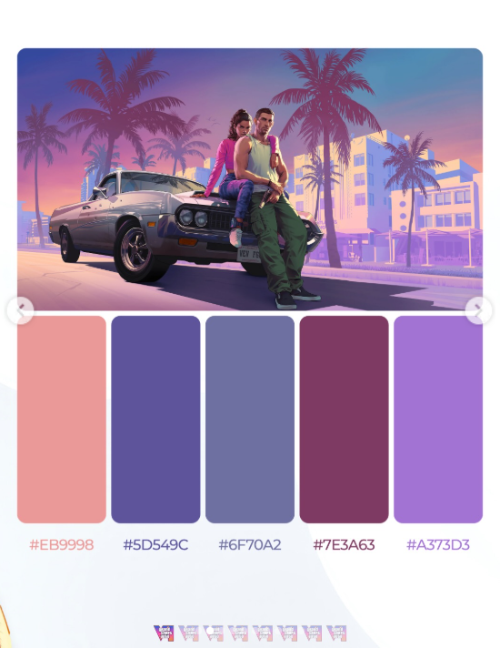
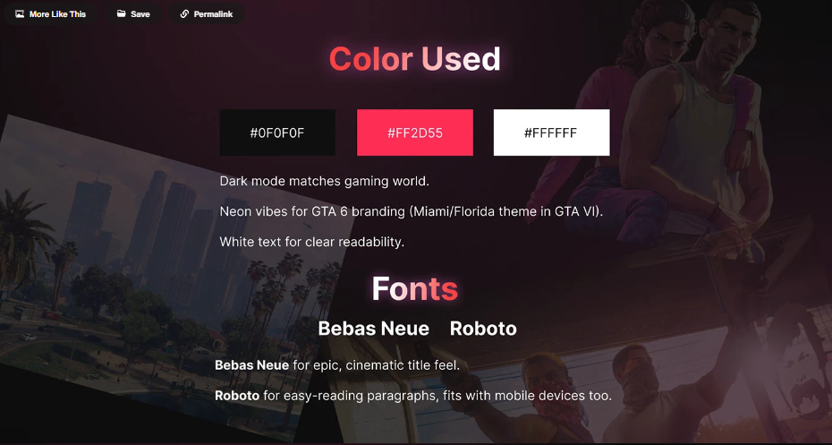

# GTA VI — Stílusirány

## Megjelenés

Vice City hangulat: naplementés háttér, rózsaszín-lila kiemelések,
karakteres címek és áttetsző, sötét kezelőfelületek.

- A háttérkép maradjon látható a panelek mögött.
- Kártyák és menük: áttetsző sötét háttér, finom háttérelmosás.
- Vékony keretek, 12–16 px lekerekítés, visszafogott neonhatás.
- Az adatbázisnál és a térképnél az olvashatóság az első.

## Színek

| Szerep | Szín |
| --- | --- |
| Sötét alap | `#0F0F0F` |
| Szöveg | `#FFFFFF` |
| Elsődleges kiemelés | `#FF2D55` |
| Lazacrózsaszín | `#EB9998` |
| Mélylila | `#5D549C` |
| Tompa levendula | `#6F70A2` |
| Szilva | `#7E3A63` |
| Világoslila | `#A373D3` |

- Panelháttér: `rgba(15, 15, 15, 0.75)`.
- Finom keret: `rgba(255, 255, 255, 0.12)`.
- Háttérelmosás: 12–16 px.
- A szöveg és a háttér kontrasztja mindenhol legyen megfelelő.

## Betűtípusok

- **Bebas Neue:** főcímek és szekciócímek.
- **Roboto:** szövegek, navigáció, gombok és adatok.
- Törzsszöveg: 16 px; kisebb feliratok: 14 px.
- A címek legyenek nagyok, rövidek és hangsúlyosak.

## Háttérkép

A naplementés kép adja az oldal vizuális alapját.
Kitöltő háttérként jelenjen meg, szükség szerint sötét fedőréteggel.
Mobilon a kivágást külön ellenőrizni kell.

## Logós illusztráció

Kiemelt főoldali képként használható, eredeti képaránnyal.
A logót ne vágjuk le, és ne helyezzünk rá további szöveget.
A kép saját hátteret tartalmaz, nem átlátszó logófájl.

## Fő elemek

- **Fejléc:** áttetsző sötét felület, rózsaszín aktív menüpont.
- **Gombok:** rózsaszín elsődleges, áttetsző másodlagos változat.
- **Autókártyák:** egységes képek, jól látható név és fő adatok.
- **Adatbázis:** kereső, szűrők és reszponzív kártyarács.
- **Térkép:** nagy térképfelület, áttetsző kereső- és szűrőpanelek.
- **Animációk:** finom, 150–250 ms átmenetek.

Mobilon egyoszlopos kártyarács és összecsukható szűrők legyenek.
Minden interaktív elem kapjon jól látható fókuszállapotot.